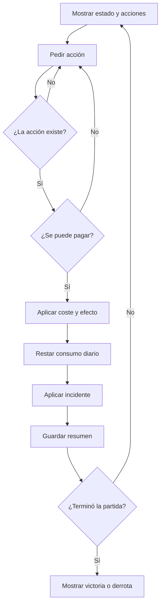

# Miniproyecto. Búnker 13

## Descripción

Simulador de supervivencia por turnos para la terminal, hecho con Node.js.
Cinco personas se refugian en el Búnker 13 durante un apocalipsis zombi y hay
que sobrevivir un máximo de 10 turnos (un turno es un día). En cada turno se
elige una acción, el grupo consume recursos y puede ocurrir un incidente. Incluye
la **opción C** (puntuación final y rango).

Todo el código está en un único archivo, `simulador.js`, con JSDoc en las funciones.

## Cómo ejecutarlo

Desde la carpeta donde está `simulador.js`:

```
npm install readline-sync
node simulador.js
```

Si en Windows PowerShell bloquea `npm`, se puede usar el símbolo del sistema (`cmd`).

## Reglas

### Estado inicial

| Dato | Valor | Límite |
|---|---|---|
| `turno` | 1 | 10 |
| `supervivientes` | 5 | 0 a 5 |
| `agua` | 24 | capacidad 40 |
| `comida` | 30 | capacidad 50 |
| `energia` | 18 | capacidad 30 |
| `chatarra` | 6 | capacidad 20 |
| `moral` | 70 | 0 a 100 |
| `amenaza` | 15 | 0 a 100 |
| `historial` | `[]` | un resumen por turno |

Ningún valor es negativo y los recursos no superan su capacidad.

### Acciones (constante `ACCIONES`)

| Acción | Coste | Efecto | Amenaza |
|---|---|---|---|
| `racionar` | Ninguno | Reduce a la mitad el consumo de agua y comida del turno | 0 |
| `explorar` | 2 energía | +8 agua, +10 comida, +4 chatarra | +15 |
| `reparar` | 3 chatarra y 4 energía | +8 energía | -5 |
| `cultivar` | 2 energía y 1 agua | +12 comida | +2 |
| `animar` | 1 comida | +12 moral | 0 |

### Orden de un turno

1. Se muestra el estado y las acciones.
2. Se pide una acción (se normaliza con `.trim().toLowerCase()`).
3. Si no existe, se explica el error y se vuelve a preguntar. El turno no avanza.
4. Si no se puede pagar, se explica qué falta y se vuelve a preguntar. El estado no cambia.
5. Se aplican costes y efectos.
6. Se resta el consumo diario.
7. Se aplica el incidente que corresponde a la amenaza.
8. Se ajustan los límites y se guarda el resumen en el historial.
9. Se comprueba si la partida ha terminado. Si no, empieza el turno siguiente.

### Consumo diario

Cada persona gasta 1 de agua, 2 de comida y 1 de energía. Con cinco personas son
5, 10 y 5. Se calcula con los supervivientes que hay al empezar el consumo.
`racionar` reduce a la mitad el agua y la comida (hacia abajo) y no toca la energía:
con 5 personas son 2, 5 y 5. Si un recurso no alcanza, queda en 0 y la partida
termina por falta de ese recurso.

### Incidentes

| Amenaza | Incidente | Efecto |
|---|---|---|
| 0 a 39 | Ninguno | Sin cambios |
| 40 a 69 | Alarma exterior | -5 moral |
| 70 a 100 | Ataque zombi | -1 superviviente y -10 moral |

### Final de la partida

- **Victoria:** se completa el turno 10, queda al menos una persona y la moral es mayor que 0.
- **Derrota:** el agua, la comida, la energía o la moral llegan a 0, o no queda nadie.
  Si se cumplen varias a la vez, el motivo que se muestra es el primero en este orden:
  agua, comida, energía, moral, supervivientes.

### Opción C. Puntuación y rango

Solo se calcula en una victoria y se muestra en la pantalla final.

| Concepto | Puntos |
|---|---|
| Cada superviviente | +100 |
| Cada unidad sobrante de agua, comida, energía y chatarra | +2 |
| Cada punto de moral | +5 |
| Ninguna baja en los 10 turnos | +250 |
| Cada punto de amenaza residual | -3 |

| Rango | Puntos | Significado |
|---|---|---|
| S | más de 800 | Estrategia legendaria |
| A | 650 a 800 | Supervivencia excelente |
| B | 500 a 649 | Supervivencia aceptable |
| C | menos de 500 | Supervivencia crítica |

El enunciado deja sin asignar el 800 exacto (S es "más de 800" y A llega a 799).
Aquí el 800 es rango A.

## Funciones

| Función | Qué hace |
|---|---|
| `crearEstadoInicial()` | Crea y devuelve un estado inicial nuevo |
| `validarEstado(estado)` | Comprueba que existen los datos y que sus valores son correctos. Si no, lanza `Error` |
| `puedeEjecutarse(estado, accion)` | `true` si la acción existe y se pueden pagar sus costes; si no, `false` |
| `aplicarAccion(estado, accion)` | Aplica costes y efectos y devuelve un estado nuevo, sin cambiar el recibido |
| `resolverTurno(estado, accion)` | Resuelve el turno completo y devuelve `{ estado, resumen }`. El estado ya está en el turno siguiente |
| `comprobarFinal(estado)` | Devuelve `{ terminado, resultado, motivo }`. Si la partida sigue, `resultado` y `motivo` son `null` |
| `calcularPuntuacion(estado)` | Opción C. Devuelve el desglose, el total y el rango de una partida ganada |

Las funciones auxiliares (`copiarEstado`, `ajustarLimites`, `calcularConsumo`,
`elegirIncidente`, `recursosQueFaltan`...) están en el mismo archivo. El programa de
terminal lo forman `mostrarRecursos`, `mostrarFinal`, `pedirAccion` y `jugarPartida`.

Ninguna función cambia el estado que recibe: todas devuelven copias hechas con
el operador de propagación (`...`). Los `for` tienen límite visible: uno por
turno (máximo 10) y uno por intento de pregunta (máximo 20 fallos seguidos, para
no quedarse atascado si la entrada se acaba).

El turno 10 se resuelve y el estado pasa a `turno: 11`. Esa es la señal que usa
`comprobarFinal` para la victoria, y `resolverTurno` lanza `Error` si se intenta
jugar más allá del turno 10.

## Diagrama de un turno



## Transcripción de una partida

Partida real con `node simulador.js`. Incluye una acción que no existe (`volar`),
un espacio y mayúsculas que se normalizan, y una acción que no se puede pagar
(`reparar` en el turno 5).

```
BÚNKER 13: sobrevive 10 días.

Turno 1 de 10
  Agua 24/40 | Comida 30/50 | Energía 18/30 | Chatarra 6/20
  Amenaza: 15 | Moral: 70 | Supervivientes: 5
  Acciones: racionar, explorar, reparar, cultivar, animar
Elige una acción: volar
  "volar" no es una acción. Elige una de: racionar, explorar, reparar, cultivar, animar
Elige una acción:   RACIONAR 
  Turno 1 | Acción: racionar | Incidente: Ninguno
  Consumo: agua 2, comida 5, energía 5
  Agua 22/40 | Comida 25/50 | Energía 13/30 | Chatarra 6/20
  Amenaza: 15 | Moral: 70 | Supervivientes: 5

Turno 2 de 10
  Agua 22/40 | Comida 25/50 | Energía 13/30 | Chatarra 6/20
  Amenaza: 15 | Moral: 70 | Supervivientes: 5
  Acciones: racionar, explorar, reparar, cultivar, animar
Elige una acción: racionar
  Turno 2 | Acción: racionar | Incidente: Ninguno
  Consumo: agua 2, comida 5, energía 5
  Agua 20/40 | Comida 20/50 | Energía 8/30 | Chatarra 6/20
  Amenaza: 15 | Moral: 70 | Supervivientes: 5

Turno 3 de 10
  Agua 20/40 | Comida 20/50 | Energía 8/30 | Chatarra 6/20
  Amenaza: 15 | Moral: 70 | Supervivientes: 5
  Acciones: racionar, explorar, reparar, cultivar, animar
Elige una acción: reparar
  Turno 3 | Acción: reparar | Incidente: Ninguno
  Consumo: agua 5, comida 10, energía 5
  Agua 15/40 | Comida 10/50 | Energía 7/30 | Chatarra 3/20
  Amenaza: 10 | Moral: 70 | Supervivientes: 5

Turno 4 de 10
  Agua 15/40 | Comida 10/50 | Energía 7/30 | Chatarra 3/20
  Amenaza: 10 | Moral: 70 | Supervivientes: 5
  Acciones: racionar, explorar, reparar, cultivar, animar
Elige una acción: racionar
  Turno 4 | Acción: racionar | Incidente: Ninguno
  Consumo: agua 2, comida 5, energía 5
  Agua 13/40 | Comida 5/50 | Energía 2/30 | Chatarra 3/20
  Amenaza: 10 | Moral: 70 | Supervivientes: 5

Turno 5 de 10
  Agua 13/40 | Comida 5/50 | Energía 2/30 | Chatarra 3/20
  Amenaza: 10 | Moral: 70 | Supervivientes: 5
  Acciones: racionar, explorar, reparar, cultivar, animar
Elige una acción: reparar
  No puedes reparar: faltan energía (tienes 2, necesitas 4)
Elige una acción: racionar
  Turno 5 | Acción: racionar | Incidente: Ninguno
  Consumo: agua 2, comida 5, energía 5
  Agua 11/40 | Comida 0/50 | Energía 0/30 | Chatarra 3/20
  Amenaza: 10 | Moral: 70 | Supervivientes: 5

DERROTA
Motivo: El grupo se ha quedado sin comida
```

## Estrategias

### Estrategia perdedora: `explorar` diez veces

| Turno | Acción | Incidente | Agua | Comida | Energía | Chatarra | Moral | Amenaza | Superv. |
|---|---|---|---|---|---|---|---|---|---|
| 1 | `explorar` | Ninguno | 27 | 30 | 11 | 10 | 70 | 30 | 5 |
| 2 | `explorar` | Alarma exterior | 30 | 30 | 4 | 14 | 65 | 45 | 5 |
| 3 | `explorar` | Alarma exterior | 33 | 30 | 0 | 18 | 60 | 60 | 5 |

Resultado: **derrota en el turno 3**, por falta de energía.

`explorar` da más recursos que `cultivar` (8 de agua, 10 de comida y 4 de chatarra,
frente a 12 de comida), pero sube la amenaza 15 puntos en vez de 2. La amenaza
cruza el tramo de la alarma exterior (40) en el turno 2 y llegaría al de los
ataques zombi (70) en el turno 4, con 75. Con esta estrategia la partida acaba
antes por la energía: cada exploración cuesta 2 y el consumo diario gasta 5,
así que a los tres turnos se agota. Si se sobreviviera, cada ataque zombi
restaría un superviviente y 10 de moral.

### La estrategia ganadora: no existe con estas reglas

Con las cifras del enunciado, **ninguna secuencia de acciones llega a la victoria**.
Se comprobó probando todas las secuencias posibles (cinco acciones por turno,
parando en cuanto la partida acaba): son 686 jugadas, ninguna gana y la que más
dura llega a 5 turnos.

El motivo es el balance. Diez turnos necesitan 50 de energía y 100 de comida
solo en consumo diario, y el grupo parte con 18 y 30. Cada `reparar` da una
ganancia neta de 4 de energía y cada `cultivar` gasta 2 de energía para producir
12 de comida, mientras que cada acción ocupa un turno entero.

La estrategia que más aguanta, **cinco turnos**, es esta:

| Turno | Acción | Incidente | Agua | Comida | Energía | Chatarra | Moral | Amenaza | Superv. |
|---|---|---|---|---|---|---|---|---|---|
| 1 | `racionar` | Ninguno | 22 | 25 | 13 | 6 | 70 | 15 | 5 |
| 2 | `racionar` | Ninguno | 20 | 20 | 8 | 6 | 70 | 15 | 5 |
| 3 | `reparar` | Ninguno | 15 | 10 | 7 | 3 | 70 | 10 | 5 |
| 4 | `racionar` | Ninguno | 13 | 5 | 2 | 3 | 70 | 10 | 5 |
| 5 | `racionar` | Ninguno | 11 | 0 | 0 | 3 | 70 | 10 | 5 |

Resultado: derrota en el turno 5, por falta de comida (la energía también llega a 0).

Como en la práctica no se puede ganar, la pantalla de victoria y la puntuación se
comprobaron con un estado de ejemplo (turno 10 completado, agua 10, comida 20,
energía 5, chatarra 5, moral 60, amenaza 20 y cinco supervivientes):

```
VICTORIA
Motivo: Se han completado los 10 turnos con 5 supervivientes y moral 60

Puntuación:
  Supervivientes (5 x 100)                   500
  Recursos sobrantes (40 x 2)                 80
  Moral (60 x 5)                             300
  Rescate perfecto (sin bajas)               250
  Amenaza residual (20 x -3)                 -60
  TOTAL                                     1070
Rango S: Estrategia legendaria
```

## Comprobación

Los casos de la tabla del enunciado (acción disponible y desconocida, faltan recursos,
producción por encima de la capacidad, consumo, `racionar`, tramos de incidente,
victoria y derrota, estado inmutable) se comprobaron con unas 90 pruebas aparte,
que no forman parte de la entrega, y jugando partidas completas.

## Decisiones de diseño

- **Incidente:** se elige con la amenaza que queda tras la acción. El consumo no la cambia, así que es la misma que "tras el consumo".
- **Un recurso que llega justo a 0** cuenta como derrota, igual que uno que se queda corto.
- **Costes:** se puede gastar todo el recurso (por ejemplo, quedarse en 0 de chatarra al reparar).
- **Entrada:** se usa `readline-sync`, como pide esta versión del enunciado.
- **Errores:** `validarEstado` y las funciones que reciben un estado o una acción incorrectos lanzan `Error`. En la partida interactiva no ocurre, porque la acción se valida antes con `puedeEjecutarse`.
- **Sin igualdad débil ni `var`:** todo con `const`/`let`, `===` y `"use strict"`.
